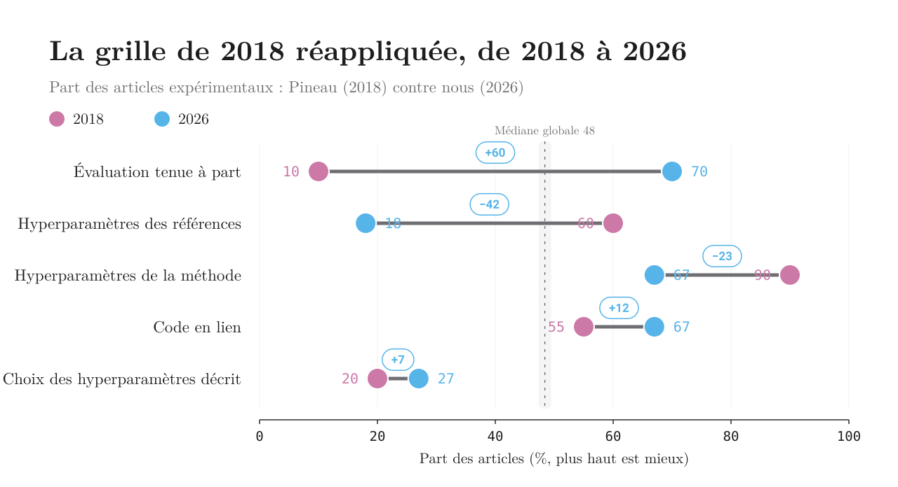
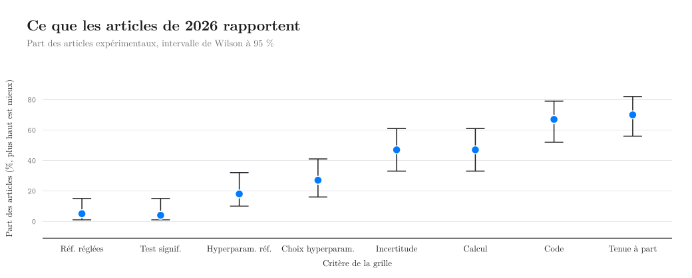
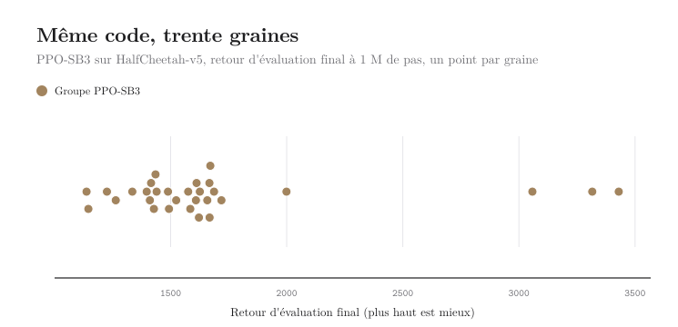
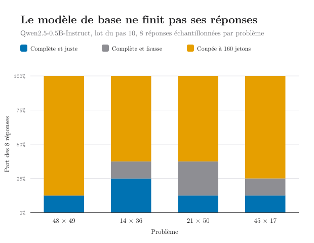

# Résumé {.unnumbered}

En 2018, Joelle Pineau a passé 50 articles d'apprentissage par renforcement (RL) au crible d'une
grille de reproductibilité, et montré avec Henderson et al. qu'un même code, lancé avec deux graines,
peut ressembler à deux algorithmes [@pineau2018iclr; @pineau2018neurips; @henderson2018matters].
Notre approche, *survey, revisited*, refait ce travail sur deux plans. D'abord le sondage : la même
grille, appliquée à 50 articles tirés au hasard parmi les 1 252 articles de RL d'ICLR 2026, d'ICML
2026 et de NeurIPS 2025. Ensuite les expériences : celles de 2018, relancées avec les algorithmes de
2026 et sous les règles que la grille réclame, protocole écrit avant le premier entraînement.

Trois résultats sont acquis à ce jour. (1) L'évaluation tenue à part est passée de 10 % à 70 % des
articles, mais les hyperparamètres des références ne sont plus donnés que dans 18 % des articles
(60 % en 2018) et le test de significativité reste à 4 %. (2) Sur 30 graines de PPO, deux groupes de
cinq tirés au hasard ne trompent le test de Welch que dans 1,2 % des cas ; ce qui trompe, c'est
l'écart apparent (17 % en médiane), la coupe « cinq meilleures contre cinq pires » (31 % de faux
positifs) et la sélection des trois meilleures sur dix (+33 %). (3) Notre propre référence « mal
réglée » l'était d'abord par nous. Le reste du programme (E2 à E5, E7, GRPO) est en cours ; ce
document le dit section par section.

# Introduction

La conférence invitée de Pineau à ICLR 2018 tient en une thèse : un résultat n'est crédible que s'il
est reproductible, et le RL profond ne l'était pas [@pineau2018iclr]. Elle s'appuyait sur deux
mesures. Un sondage de 50 articles, où environ 5 % font un test de significativité, et une série
d'expériences sur MuJoCo [@todorov2012mujoco] où le classement des algorithmes change d'une tâche à
l'autre, où deux implémentations du même algorithme divergent, et où deux paquets de cinq graines du
même code TRPO dessinent deux courbes séparées [@henderson2018matters]. L'argument rejoint celui de
Buckheit et Donoho : un article est la publicité de la recherche, pas la recherche
[@buckheit1995wavelab]. Il s'inscrit dans une inquiétude plus large, mesurée la même année par
*Nature* [@baker2016reproducibility].

Depuis, la liste de contrôle de NeurIPS 2019, issue du programme qu'elle a dirigé, est devenue la
norme [@pineau2021improving] ; les statistiques du RL ont été revues [@agarwal2021precipice] ; les
détails d'implémentation ont été mesurés [@engstrom2020implementation; @andrychowicz2021matters].
Le RL a aussi changé de terrain : il affine désormais de grands modèles de langue à partir de
récompenses vérifiables [@shao2024deepseekmath; @deepseek2025r1], et les mêmes pièges y
reparaissent. Une récompense tirée au sort y « marche » sur une famille de modèles et pas sur les
autres [@shao2025spurious] ; le gain en pass@1 peut se payer en pass@k [@yue2025rlvr].

*Survey, revisited* pose donc deux questions. La grille de 2018 a-t-elle changé les pratiques ?
Et nos propres expériences survivent-elles aux règles que nous appliquons aux autres ?

# Méthode

## Le sondage, refait

Population : les 1 252 articles de RL d'ICLR 2026, d'ICML 2026 et de NeurIPS 2025. Échantillon :
50 articles tirés au hasard (27 sur le RL de grands modèles, 14 de RL classique, 9 de théorie dont
5 sans expérience). Grille : celle de Pineau, complétée de quatre critères qu'elle ne chiffrait pas
(incertitude rapportée, références réglées comme la méthode, calcul rapporté, sélection visible des
meilleurs essais). Calibration : 12 articles de RL d'ICML et de NeurIPS 2018, même grille, mêmes
lecteurs. Fidélité : deux lecteurs indépendants sur 10 articles s'accordent sur 127 décisions sur 130
(98 %). Les parts sont calculées sur les articles expérimentaux, avec l'intervalle de Wilson à
95 % [@wilson1927probable]. Protocole complet dans `study/PROTOCOL.md`.

## Les expériences, refaites

Le protocole `sim/SIM_PROTOCOL.md` a été écrit le 8 novembre 2026, avant tout entraînement ; tout
changement ultérieur est consigné dans sa section « Écarts » avant d'avoir vu les résultats qu'il
touche, ou signalé comme postérieur. Outils figés : Gymnasium 1.1.1 [@towers2024gymnasium],
MuJoCo, Stable-Baselines3 2.6.0 [@raffin2021sb3] et sa version JAX. Algorithmes : PPO
[@schulman2017ppo] en deux implémentations, SAC [@haarnoja2018sac] et CrossQ [@bhatt2024crossq].
Tâches : HalfCheetah, Hopper, Walker2d et Swimmer (`-v5`). Dix graines par couple (algorithme,
tâche), trente pour E1, aucune retirée. Évaluation tenue à part : graines d'évaluation jamais vues à
l'entraînement, plus des dynamiques modifiées (masses × 1,2, frottement × 0,8).

| Exp. | Question | État au 9 novembre |
|:----|:----------------------------------------------|:-----------------------|
| E1 | Deux groupes du même code ressemblent-ils à deux algorithmes ? | fini, analysé |
| E2 | Le classement change-t-il d'une tâche à l'autre ? | en cours |
| E3 | Deux implémentations du même algorithme diffèrent-elles ? | en cours |
| E4 | Que font les trois meilleurs essais sur dix ? | après E2 |
| E5 | Combien de graines pour retrouver le bon classement ? | après E2 |
| E6 | Que vaut une référence mal réglée ? | premier passage fini, diagnostic en cours |
| E7 | Que perd-on hors des dynamiques d'entraînement ? | après E2 |

: Le programme expérimental et son état.

## Le volet grands modèles

GRPO [@shao2024deepseekmath] écrit à la main, sur un portable Apple, à petite échelle annoncée
d'avance : Qwen2.5-0.5B-Instruct [@qwen2025qwen25] et Llama-3.2-1B-Instruct
[@grattafiori2024llama3], produit de deux nombres de 12 à 99, vraie récompense contre récompense
tirée au sort, comme Shao et al. [-@shao2025spurious]. Protocole : `sim/llm/LLM_PROTOCOL.md`.

# Résultats

## Le sondage : ce qui a bougé, ce qui n'a pas bougé

{#fig:remesure width=100%}

| Critère | Pineau 2018 | Nous, calibration 2018 | Nous, 2026 [IC 95 %] |
|:------------------------------------|--------:|----------:|-------------:|
| Hyperparamètres de la méthode, tous | 90 % | 6/10 | 67 % [52, 79] |
| Hyperparamètres des références, tous | 60 % | 6/11 | **18 % [10, 32]** |
| Code en lien | 55 % | 6/11 | 67 % [52, 79] |
| Méthode de choix des hyperparamètres | 20 % | 2/10 | 27 % [16, 41] |
| Évaluation tenue à part | 10 % | 4/10 | **70 % [56, 82]** |
| Test de significativité | 5 % | 1/11 | 4 % [1, 15] |
| Incertitude rapportée | n.d. | 8/11 | 47 % [33, 61] |
| Références réglées comme la méthode | n.d. | 4/10 | 5 % [1, 15] |
| Calcul rapporté | n.d. | 4/11 | 47 % [33, 61] |

: La grille de Pineau réappliquée. Données : `study/results_final.json`.

Un seul progrès net : l'évaluation tenue à part, portée par le RL de grands modèles (26 articles sur
27, contre 5 sur 13 en RL classique). Une régression nette : les hyperparamètres des références. Le
reste n'a pas bougé, test de significativité compris. L'incertitude rapportée baisse, mais la baisse
vient du RL de grands modèles (4 articles sur 27) ; le RL classique la rapporte toujours (14 sur 14).

{#fig:remesure-ic width=100%}

Graines : sur 41 articles de RL expérimentaux, 20 ne disent pas combien d'entraînements
indépendants soutiennent leurs résultats, 4 n'en ont qu'un, et la médiane des autres est 5. En RL de
grands modèles, 15 articles sur 27 n'essaient qu'une famille de modèles de base, alors que Shao et
al. montrent qu'un effet peut ne valoir que pour une famille [-@shao2025spurious].

## E1 : même code, autre graine

{#fig:e1 width=100%}

La distribution n'a rien de gaussien (Shapiro-Wilk, p = 4 × 10^−7^). Vingt-sept graines finissent
entre 1 138 et 1 999 ; trois décollent au-delà de 3 000. Tirer cinq graines, c'est donc tirer ou non
l'une de ces trois-là.

![Part des 10 000 tirages où le test de Welch [@welch1947generalization] déclare différents deux groupes du même code. Au hasard, le test est même prudent (1,2 % à 1,7 % pour un seuil de 5 %) ; la coupe triée le trompe une fois sur trois.](figures/e1-false-positive.svg){#fig:e1-fp width=90%}

| Façon de former les groupes | Faux positifs (p < 0,05) | Écart apparent médian | 95^e^ centile de l'écart |
|:-----------------------------------|----------:|----------:|----------:|
| 3 contre 3, au hasard | 1,6 % | 17 % | 62 % |
| 5 contre 5, au hasard | 1,2 % | 17 % | 47 % |
| 10 contre 10, au hasard | 1,7 % | 11 % | 33 % |
| 5 meilleures contre 5 pires, sur 10 | 31,0 % | 42 % | — |

: E1, 10 000 tirages par ligne. Écart apparent : |moyenne A − moyenne B| / min(moyennes). Données : `sim/analysis/e1.json`.

Ce résultat corrige notre propre lecture de 2018. Deux paquets de cinq graines tirés au hasard ne
trompent presque jamais un test ; ils trompent l'œil. Un écart de 17 % entre deux courbes est la
norme sans aucune différence d'algorithme, et un écart de 47 % arrive une fois sur vingt. Ce qui
trompe le test, c'est la coupe triée de la figure de 2018 : 31 % de faux positifs. La sélection
trompe la moyenne : garder les trois meilleures graines sur dix la gonfle de 33 % (2 249 contre
1 692). Henderson et al. rapportent t = −9,09 et p = 0,0016 entre deux groupes de cinq ; leur
légende précise que ce p est la moyenne des tests faits le long de la courbe d'apprentissage, pas un
test sur les scores finaux, et l'article ne dit pas comment les dix essais ont été coupés en deux
[@henderson2018matters].

## E6 : la référence mal réglée, c'était nous

E6 compare PPO sur Hopper avec les réglages par défaut de la bibliothèque et avec les réglages
publiés par RL Baselines3 Zoo [@raffin2020zoo]. Le premier passage donne au défaut une IQM de 2 877
[2 272, 3 346] et au Zoo 1 003 [859, 1 156], le Zoo plafonnant à 1 000 dès 50 000 pas. Ce résultat
surprenant a déclenché une vérification : notre normalisation des observations gardait γ = 0,99 là
où le Zoo prend celui de l'algorithme, 0,999. La « référence mal réglée » était d'abord la nôtre. Le
premier passage est conservé tel quel ; la recette corrigée a été relancée sur Hopper-v5 et v4 (la
version des réglages publiés), avec le défaut sur v4, dix graines chacun. Ce diagnostic, ajouté après
avoir vu le premier résultat, est déclaré comme tel ; ses deux dernières graines tournent.

## GRPO : ce que mesurait vraiment la vraie récompense

Le pilote du taux d'apprentissage a été arrêté au pas 10 (65 Go de mémoire, 29 Go de swap), sur une
anomalie : 91 % de réponses justes à l'entraînement, contre 11 % en pass@1 au test. Nous avons rejoué
sans entraînement le lot exact du pas 10 (48 × 49, 14 × 36, 21 × 50, 45 × 17) avec le modèle de base.

{#fig:grpo width=80%}

Le modèle de base n'y fait que 5 sur 32, comme au test : le lot n'est pas facile, et le décompte est
juste. Mais 23 réponses sur 32 sont coupées à 160 jetons, et aucune n'est juste ; parmi les 9
réponses complètes, 5 le sont. Le faible score de départ mesure donc surtout la longueur, et la vraie
récompense apprend d'abord à finir avant la coupure. La récompense tirée au sort n'a pas ce levier.
Toute comparaison entre les deux conditions doit séparer le gain de longueur du gain d'arithmétique :
la part de réponses coupées est désormais mesurée à l'entraînement et au test. Une version réduite
(100 pas, trois graines, un entraînement à la fois, mémoire plafonnée) est lancée.

# Discussion

Huit ans après, la grille de Pineau a gagné une bataille, l'évaluation tenue à part, et en a perdu
une, la description des références. Le progrès vient surtout du RL de grands modèles, dont les bancs
d'essai ont un jeu de test par construction ; d'où vient la régression, notre échantillon ne permet
pas de le dire. Le test de significativité, lui, n'a jamais pris.

Nos expériences nuancent la figure la plus célèbre de 2018. Le hasard des graines ne fabrique pas de
faux positifs au rythme qu'on croit ; il fabrique des écarts visibles, et ce sont nos choix (trier,
garder les meilleurs) qui les transforment en faux positifs. La règle utile n'est donc pas seulement
« plus de graines », mais « des graines qu'on ne trie pas, et un intervalle plutôt qu'une courbe ».
E5 dira combien.

Enfin, E6 et le diagnostic GRPO rappellent que la grille s'applique d'abord à soi. Nous avons mal
réglé la référence que nous voulions montrer mal réglée, et notre premier indicateur GRPO mesurait
une limite de longueur. Les deux erreurs ont été trouvées parce que le protocole était écrit d'avance
et que les résultats surprenants ont été vérifiés plutôt que publiés.

# Limites

Le sondage porte sur 50 articles : les intervalles sont larges, et seuls les écarts de plus de
quinze points avec 2018 sont lisibles. Notre calibration 2018 est plus sévère que la lecture de
Pineau pour les hyperparamètres de la méthode. E1 porte sur une seule tâche et un seul algorithme.
Le volet GRPO est une illustration sur des modèles de 0,5 et 1 milliard de paramètres, pas une
réplication de Shao et al.

# Ce qui reste à mesurer

E2 à E5 et E7 attendent la fin des simulations (environ 89 entraînements, 12 à 15 heures) ; E6
attend ses deux dernières graines ; GRPO réduit tourne. Chaque expérience aura son script et son
fichier JSON dans `sim/analysis/`, et ce document sera mis à jour sans retirer ce qui nous a
contredits.

# Reproductibilité

Code, protocoles, journaux d'évaluation et scripts d'analyse : `study/`, `sim/`, `sim/llm/`. Figures :
`docs/figures/build.py` les régénère toutes à partir des fichiers de résultats. Environnement figé :
`sim/requirements.lock`.

